<!-- Profile README · ZC-TigerRoot
     Header art: assets/header-*.svg (regenerate with `python scripts/build_header.py`)
     Blog list:  filled daily by .github/workflows/social-readme.yml
     Snake:      built every 12h by .github/workflows/snake.yml into the `output` branch -->

<a href="https://github.com/ZC-TigerRoot">
  <picture>
    <source media="(prefers-color-scheme: dark)" srcset="assets/header-dark.svg">
    <source media="(prefers-color-scheme: light)" srcset="assets/header-light.svg">
    
  </picture>
</a>

  <a href="https://bjtuedu.cn/">Blog</a> ·
  <a href="mailto:zc.tigerroot@tigerroot.cn">Email</a> ·
  <a href="https://twitter.com/TigerRootZC">X</a> ·
  <a href="https://www.zhihu.com/people/zhang-chi-72-32">知乎</a> ·
  <a href="https://space.bilibili.com/396791442">Bilibili</a> ·
  <a href="https://afdian.com/a/zctigerroot">爱发电</a>

 

最近两年写的东西大多围绕一个问题：**一个数字是怎么来的，能不能一路追回到原始记录。**
检测报告审核、海运报价、A 股研究都是这个问题的不同形态；业余时间则用 WebGL 给黑洞做光线追踪。

Most of what I build asks one question — <i>where did this number come from, and can we trace it back to the source?</i> — applied to lab-report audits, freight quotes and equity research. Off hours I raytrace black holes in the browser.

 

## 01 · 证据链与审核 &nbsp;EVIDENCE-FIRST AUDIT

| 项目 | 做什么 | 技术 |
|:--|:--|:--|
| [**lab-data-reconciliation**](https://github.com/ZC-TigerRoot/lab-data-reconciliation) | 实验室数据对账与审计（LDRAS）：原始文件 → 页 → 观测值 → 计算/QC → 报告值，逐值证明最终结果有原始记录支撑 | FastAPI · PostgreSQL · Celery · Vue 3 |
| [**envaudit**](https://github.com/ZC-TigerRoot/envaudit) | 环境检测报告自动审核：多模态模型单次判定，8 类审核发现，每条带来源文件、页码、原始值与判定依据 | FastAPI · React · 多模态 LLM |
| [**report-data-lineage-audit**](https://github.com/ZC-TigerRoot/report-data-lineage-audit) | 检测报告数据溯源与自动审核，DOCX / PDF 证据链 MVP | Python |
| [**detection**](https://github.com/ZC-TigerRoot/detection) | 环境监测方案管理：导入客户方案、AI 结构化、校对入库、按模板导出 Word | Python |

## 02 · 物流数字化 &nbsp;LOGISTICS

| 项目 | 做什么 | 技术 |
|:--|:--|:--|
| [**Cargo-Management**](https://github.com/ZC-TigerRoot/Cargo-Management) | 海外保税仓与国内汽车仓储的多端协同管理系统 | TypeScript |
| [**FCL-Quote**](https://github.com/ZC-TigerRoot/FCL-Quote) | 海运整箱（FCL）报价的智能结构化与审核 | Python |
| [**Price-Clarify**](https://github.com/ZC-TigerRoot/Price-Clarify) | 整箱报价的智能录入、复核与版本化管理 | Python |

## 03 · 量化研究 &nbsp;QUANT RESEARCH

| 项目 | 做什么 | 技术 |
|:--|:--|:--|
| [**ashare-research**](https://github.com/ZC-TigerRoot/ashare-research) | 沪深 300 时点正确（point-in-time）研究与模拟交易：版本化数据、走步验证、T+1 / 涨跌停撮合 | Python · DuckDB · PostgreSQL |
| [**Stock**](https://github.com/ZC-TigerRoot/Stock) | 用国内低成本大模型分析行情与消息面，Web 面板 + 历史回测 | Python · LLM |

## 04 · 图形与实验 &nbsp;GRAPHICS & SIDE QUESTS

| 项目 | 做什么 | 技术 |
|:--|:--|:--|
| **Gargantua × 3** — [GPT](https://github.com/ZC-TigerRoot/BlackHole-GPT) · [Grok](https://github.com/ZC-TigerRoot/BlachHole-Grok) · [Kimi](https://github.com/ZC-TigerRoot/BlachHole-Kimi) | 实时史瓦西黑洞零测地线光线追踪：吸积盘相对论光学、HDR 泛光。同一份需求交给三个模型各写一版 | Three.js · GLSL |
| [**campus-solar-vegetation-monitoring**](https://github.com/ZC-TigerRoot/campus-solar-vegetation-monitoring) | 校园太阳能边缘植被监测：NASA POWER 数据、本地 Gemma 推理、MATLAB 分析 | Python · MATLAB |
| [**server-probe**](https://github.com/ZC-TigerRoot/server-probe) | 轻量级服务器实时监控探针 | JavaScript |
| [**token-monitor-hub**](https://github.com/ZC-TigerRoot/token-monitor-hub) | 用 Cloudflare Worker + Durable Object 汇聚多设备的 LLM Token 用量 | Cloudflare Workers |

更早的仓库 · earlier work

 

- [SeekFree-STC32G12K128](https://github.com/ZC-TigerRoot/SeekFree-STC32G12K128) — 逐飞 STC32 嵌入式 C
- [ExcelTransform](https://github.com/ZC-TigerRoot/ExcelTransform) — Excel 数据转换脚本
- [RnSt-Website](https://github.com/ZC-TigerRoot/RnSt-Website) — RnSt 三角洲行动战队官网
- [tools](https://github.com/ZC-TigerRoot/tools) — 一组纯静态的小工具
- [zc-tigerroot.github.io](https://github.com/ZC-TigerRoot/zc-tigerroot.github.io) — 最早的个人站点

 

## 工具箱 &nbsp;STACK

## 最近在写 &nbsp;FROM THE BLOG

<!-- START_SECTION:blog -->
* <a href='https://bjtuedu.cn/index.php/archives/47/' target='_blank'>Lab Report 5B Weather Observations</a> - 2026-04-21
* <a href='https://bjtuedu.cn/index.php/archives/46/' target='_blank'>RnSt 群 / 战队管理条例</a> - 2026-02-05
* <a href='https://bjtuedu.cn/index.php/archives/45/' target='_blank'>Lecture 1 – Intro to Hydrology</a> - 2026-01-13
* <a href='https://bjtuedu.cn/index.php/archives/44/' target='_blank'>Promoting Sustainable Development Through Bicycle Systems</a> - 2025-12-08
* <a href='https://bjtuedu.cn/index.php/archives/43/' target='_blank'>TradingAgents-CN初体验</a> - 2025-08-09
<!-- END_SECTION:blog -->

 

<picture>
  <source media="(prefers-color-scheme: dark)" srcset="https://raw.githubusercontent.com/ZC-TigerRoot/ZC-TigerRoot/output/snake-dark.svg">
  <source media="(prefers-color-scheme: light)" srcset="https://raw.githubusercontent.com/ZC-TigerRoot/ZC-TigerRoot/output/snake-light.svg">
  
</picture>

工作台 · workstation

 

| | |
|:--|:--|
| 笔记本 | MECHREVO 耀世 16 Super · i9-14900HX · RTX 4080 Laptop · 32 GB DDR5-5600 |
| 存储 | YMTC PC411 1 TB + Acer Predator GM7 2 TB |
| 显示器 | LG UltraGear 27GS75Q · 2K 200 Hz |
| 外设 | Razer DeathStalker V2 Pro · IRok MG68 · Rapoo VT7Max · Razer BlackShark V2 Pro |
| 其他 | [Steam](https://steamcommunity.com/profiles/76561199193649529) · [网易云音乐](https://music.163.com/#/user/home?id=2113196632) |

 

<i>若知是梦何须醒，不比真如意向会。</i>

